# Pipelined Predicated RISC Processor

A simplified 32-bit predicated RISC processor with a 5-stage pipeline, written in Verilog and simulated in Active-HDL.

## Specifications

- 32-bit instructions and 32-bit words
- 32 general-purpose registers (R0-R31)
  - R0 is hardwired to zero
  - R30 is the PC
  - R31 is the return address register
- Separate instruction and data memories, word addressable
- **Predicated execution:** every instruction has a predicate register `Rp`. If `Rp` is zero the instruction does not execute. Use R0 as `Rp` to always execute.
- Immediates are zero-extended for logical instructions and sign-extended for the rest. Jump targets are PC + sign-extended offset.

## Instruction formats

| Type | Fields |
|------|--------|
| R-Type | Opcode (5) - Rp (5) - Rd (5) - Rs (5) - Rt (5) - Unused (7) |
| I-Type | Opcode (5) - Rp (5) - Rd (5) - Rs (5) - Immediate (12) |
| J-Type | Opcode (5) - Rp (5) - Offset (22) |

## Instruction set

| Instruction | Type | Meaning (if `Rp` != 0) | Opcode |
|-------------|------|------------------------|--------|
| ADD Rd, Rs, Rt, Rp | R | Rd = Rs + Rt | 0 |
| SUB Rd, Rs, Rt, Rp | R | Rd = Rs - Rt | 1 |
| OR Rd, Rs, Rt, Rp | R | Rd = Rs \| Rt | 2 |
| NOR Rd, Rs, Rt, Rp | R | Rd = ~(Rs \| Rt) | 3 |
| AND Rd, Rs, Rt, Rp | R | Rd = Rs & Rt | 4 |
| ADDI Rd, Rs, Imm, Rp | I | Rd = Rs + Imm | 5 |
| ORI Rd, Rs, Imm, Rp | I | Rd = Rs \| Imm | 6 |
| NORI Rd, Rs, Imm, Rp | I | Rd = ~(Rs \| Imm) | 7 |
| ANDI Rd, Rs, Imm, Rp | I | Rd = Rs & Imm | 9 |
| LW Rd, Imm(Rs), Rp | I | Rd = Mem[Rs + Imm] | 10 |
| SW Rd, Imm(Rs), Rp | I | Mem[Rs + Imm] = Rd | 11 |
| J Label, Rp | J | jump to target | 12 |
| CALL Label, Rp | J | jump, save return address in R31 | 13 |
| JR Rs, Rp | R | jump to address in Rs | 14 |

## Pipeline

Five stages: **IF -> ID -> EX -> MEM -> WB**, with pipeline registers between them (`IF_ID`, `ID_EX`, `EX_MEM`, `MEM_WB`).

Hazards and control are handled by dedicated units:

- `ForwardingUnit` - forwards results to avoid data hazards
- `StallUnit` - stalls the pipeline on load-use hazards
- `KillUnit` - flushes instructions after jumps
- `PredicateUnit` - decides whether an instruction executes
- `PC_Control` - selects the next PC

## Datapath

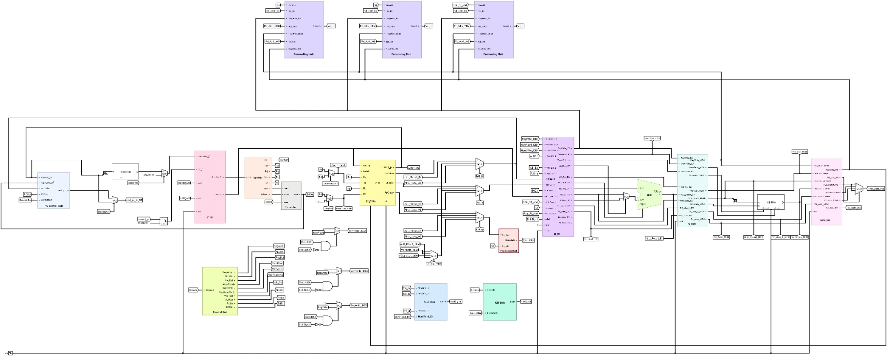

### Components

**Instruction decode** - splits the instruction into its fields

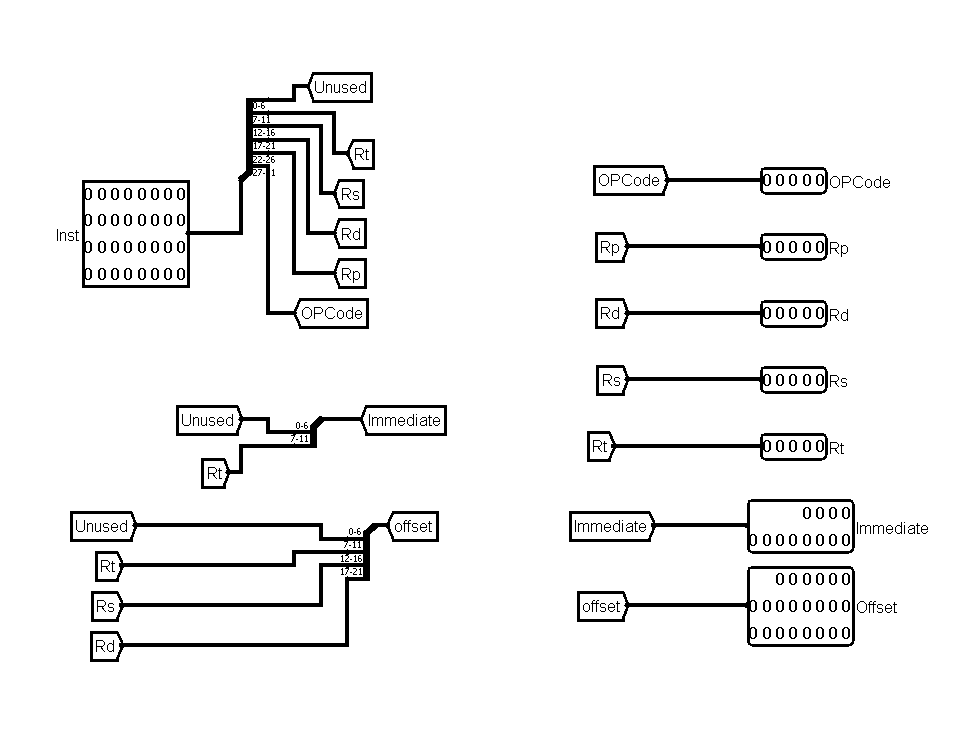

**Register file**

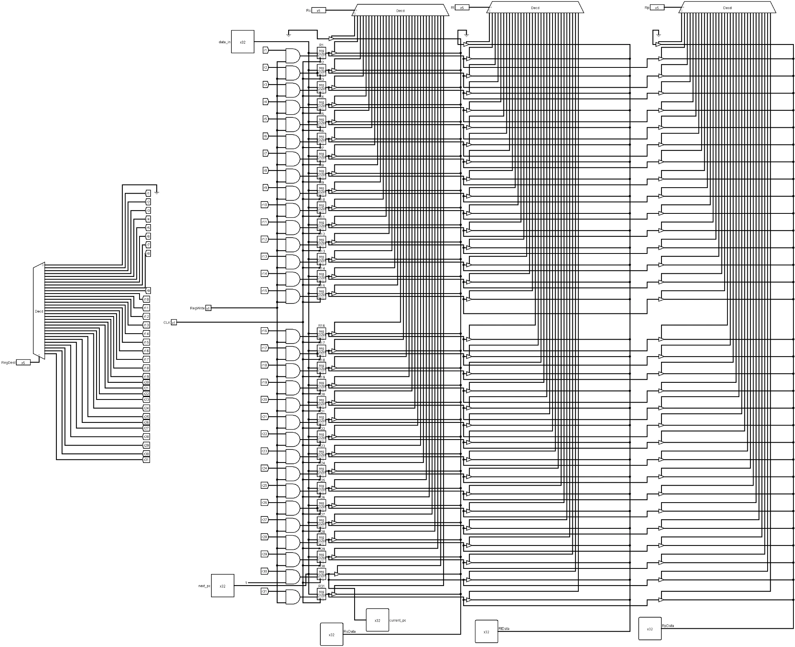

**Extender** - zero/sign extension of the immediate and offset

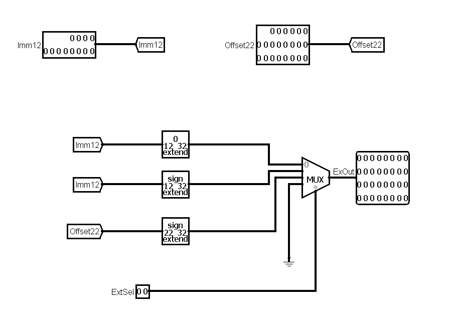

**ALU**

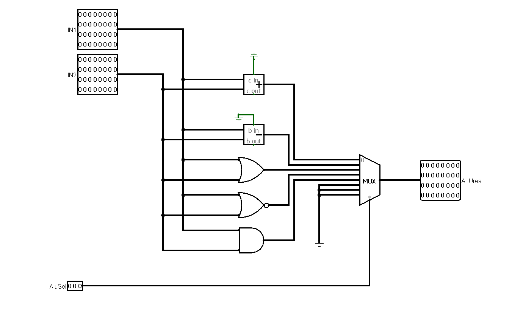

**PC control**

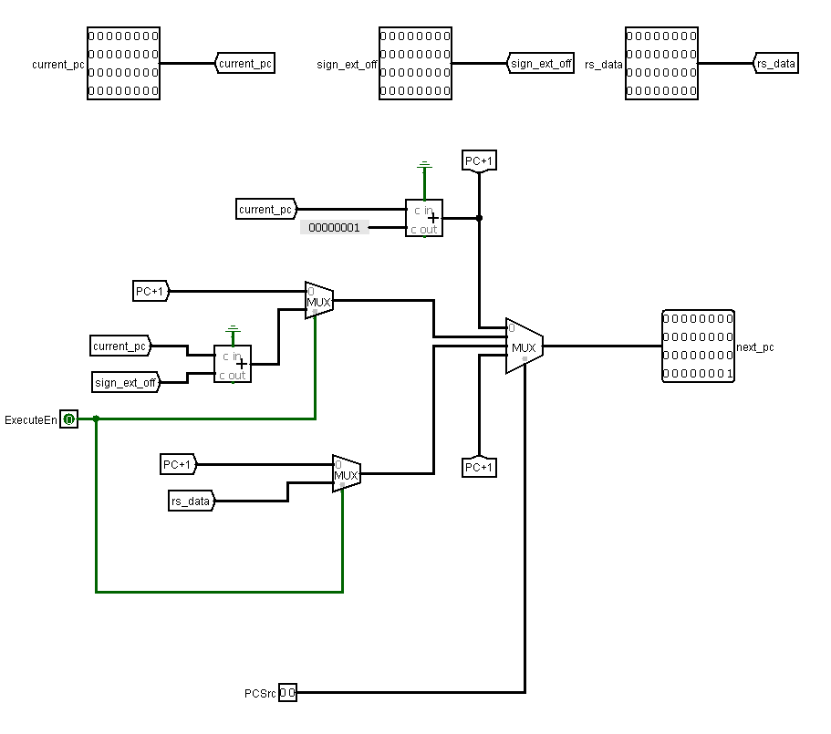

**Control unit**

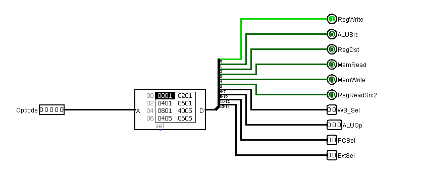

### Pipeline registers

| IF/ID | ID/EX |
|-------|-------|
| 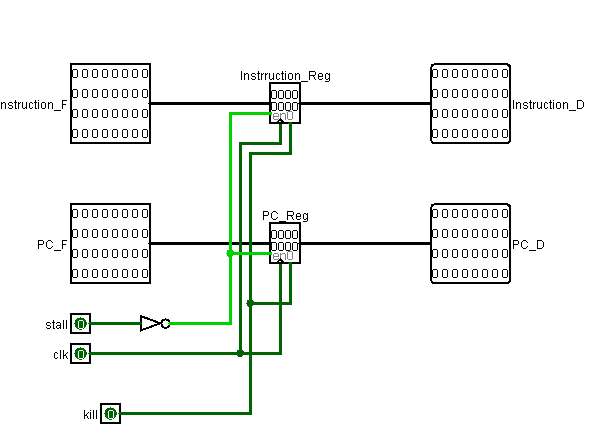 | 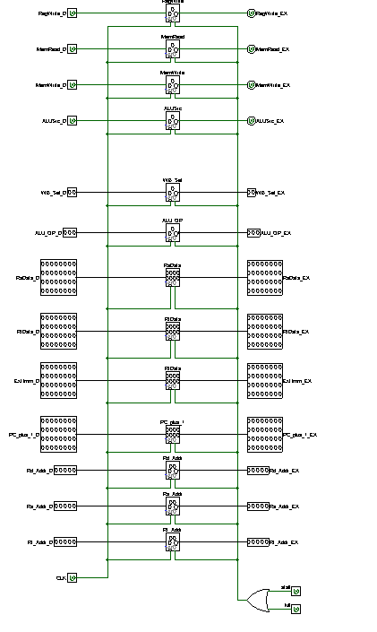 |

| EX/MEM | MEM/WB |
|--------|--------|
| 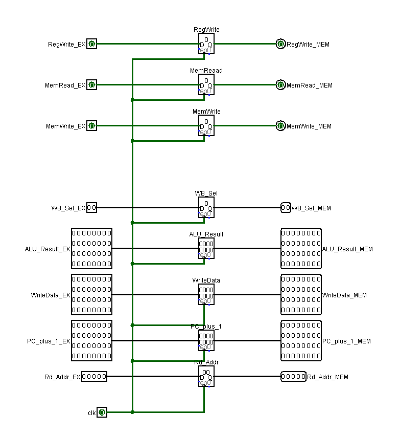 | 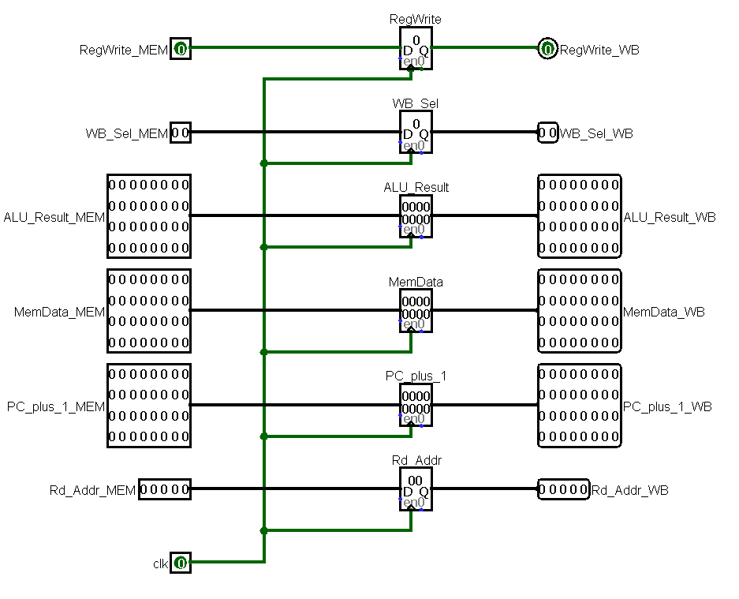 |

### Hazard and predicate units

**Forwarding unit**

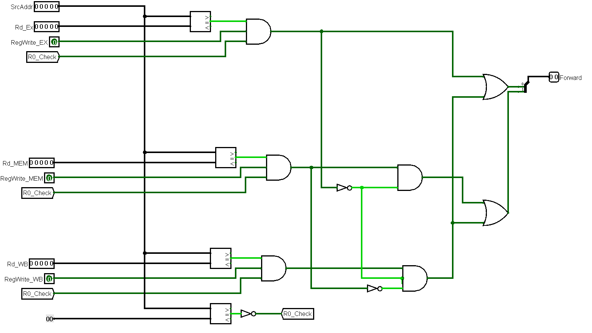

**Stall unit**

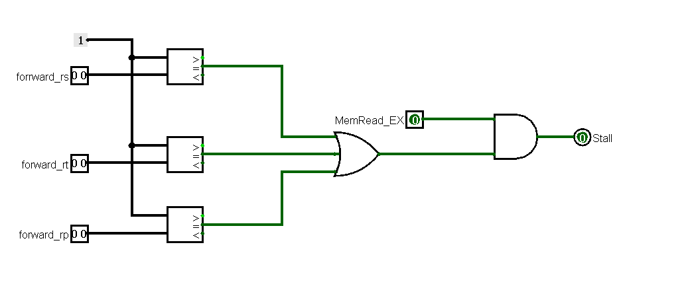

**Kill unit**

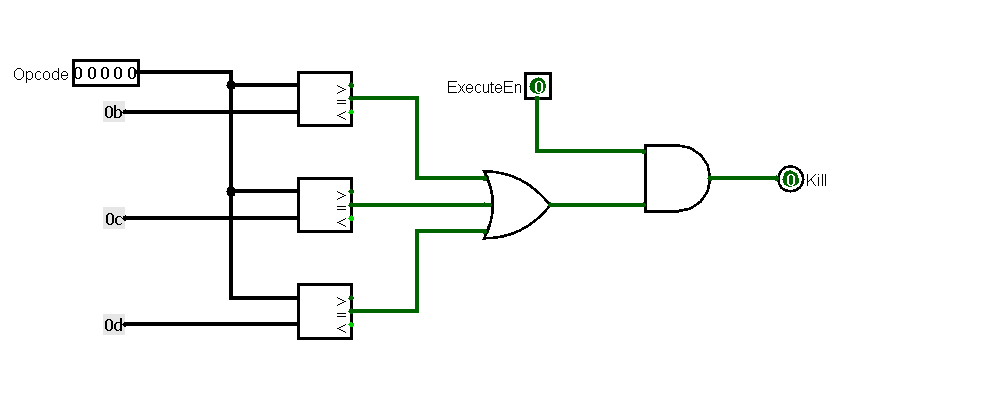

**Predicate unit**

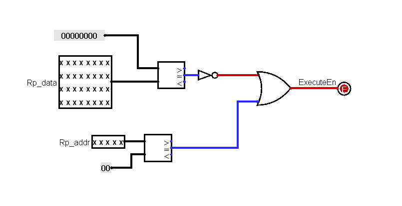

## Files

```
ArchPrj/prj2/src/           Verilog source (one module per file, with testbenches)
ArchPrj/prj2/src/inst.txt   test program in hex, loaded into instruction memory
PipelinedProcesserArch.circ datapath diagram (Logisim)
Report.pdf                  full project report
```

Top module: `PiplinedProcessor.v`

## Running

1. Open `ArchPrj/ArchPrj.aws` in Active-HDL.
2. Compile the sources in `ArchPrj/prj2/src`.
3. Simulate `PipelinedProcessor`. The instruction memory reads `inst.txt`, so keep it in the simulation working folder.
